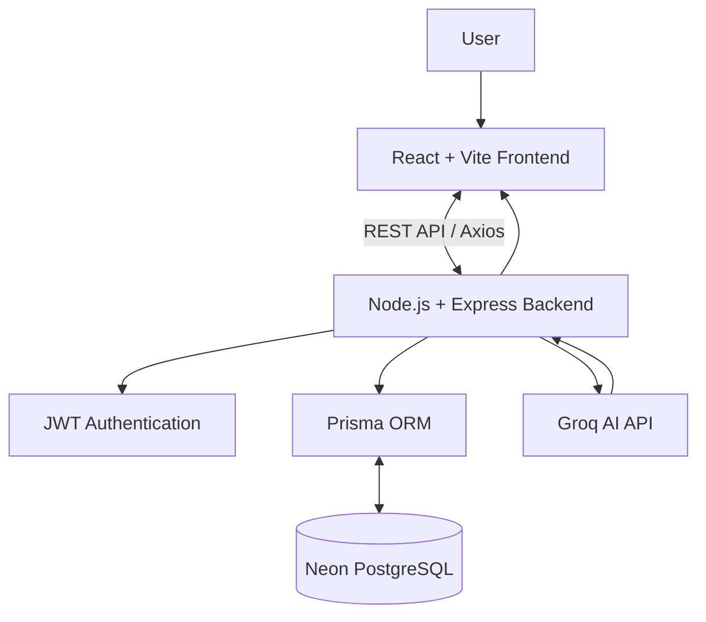
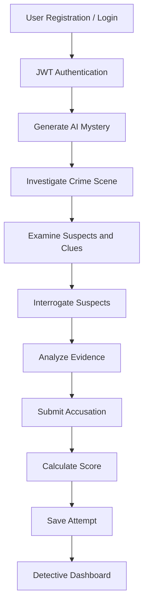

# 🕵️ AI Mystery Case

### An AI-powered interactive detective investigation platform

Investigate crimes, analyze clues, interrogate suspects, and uncover the truth.

**AI Mystery Case** is a full-stack AI-powered detective game that generates interactive mystery scenarios using Groq AI. Players investigate crime scenes, examine suspects and evidence, conduct natural-language interrogations, and identify the culprit through an accusation-based scoring system.

\<p align="center">   \<a href="[https://ai-mystery-case.vercel.app](https://ai-mystery-case.vercel.app)">\<strong>🌐 Live Demo\</strong>\</a> ·   \<a href="[https://github.com/akshay528-sys/ai-mystery-case](https://github.com/akshay528-sys/ai-mystery-case)">\<strong>📂 GitHub Repository\</strong>\</a> \</p>

---

## 📸 Application Screenshots

### 🔐 Login Page


### 🕵️ Mystery Investigation


### 💬 AI Suspect Interrogation


### 📊 Detective Dashboard


---

## ✨ Key Features

### 🤖 AI-Powered Mystery Generation

- Generates unique detective cases using Groq AI.
- Each generated mystery contains:
  - Mystery title
  - Crime description
  - Difficulty level
  - Three suspects
  - Five clues
  - Hidden solution
- Generated mysteries are validated and stored in PostgreSQL.
- The actual solution remains on the backend and is not exposed to the frontend during case generation.

### 🕵️ Interactive Detective Investigation

- View detailed crime descriptions.
- Examine suspects and their backgrounds.
- Analyze clues and available evidence.
- Investigate the case before making an accusation.

### 💬 AI-Powered Suspect Interrogation

Interrogate suspects using natural-language questions.

The AI simulates suspect responses based on the mystery context.

Suspects can:

- Answer questions naturally.
- Evade certain questions.
- Provide partial information.
- Mislead the detective.
- Maintain consistency with the case context.

Interrogation questions and responses are stored in PostgreSQL for authenticated users.

### 🎯 Accusation and Scoring System

Select a suspect and submit an accusation to solve the mystery.

| Result             |      Score |
| ------------------ | ---------: |
| Correct accusation | 100 points |
| Wrong accusation   |   0 points |

- Prevents duplicate accusations for the same case.
- Stores accusation results and scores.
- Maintains user-specific investigation history.

### 📊 Detective Dashboard

The dashboard provides an overview of detective performance:

- Total score
- Total cases attempted
- Cases solved
- Wrong accusations
- Investigation history
- Attempt date and time
- Selected suspect
- Score for each attempt

### 🔐 Authentication and Authorization

- User registration and login.
- JWT-based authentication.
- Password hashing using bcrypt.
- Protected API routes.
- User-specific attempt history.
- User-specific interrogation history.

---

## 🏗️ System Architecture

The application follows a client-server architecture with AI integration and a PostgreSQL database.



### Application Workflow



---

## 🛠️ Technology Stack

| Category        | Technologies                 |
| --------------- | ---------------------------- |
| Frontend        | React 19, Vite 8, JavaScript |
| Routing         | React Router                 |
| Styling         | CSS                          |
| HTTP Client     | Axios                        |
| Backend         | Node.js, Express.js 5        |
| Database        | PostgreSQL, Neon             |
| ORM             | Prisma 7                     |
| Authentication  | JWT, bcrypt                  |
| AI Integration  | Groq API, Groq SDK           |
| AI Model        | `openai/gpt-oss-20b`         |
| Deployment      | Vercel                       |
| Version Control | Git, GitHub                  |

---

## 📁 Project Structure

```text
ai-mystery-case/
│
├── client/
│   ├── public/
│   ├── src/
│   │   ├── components/
│   │   ├── pages/
│   │   ├── services/
│   │   └── App.jsx
│   │
│   ├── package.json
│   ├── vite.config.js
│   └── vercel.json
│
├── server/
│   ├── prisma/
│   │   ├── migrations/
│   │   └── schema.prisma
│   │
│   ├── src/
│   │   ├── controllers/
│   │   ├── routes/
│   │   ├── middleware/
│   │   ├── services/
│   │   ├── lib/
│   │   ├── generated/
│   │   ├── app.js
│   │   └── server.js
│   │
│   ├── package.json
│   └── vercel.json
│
├── screenshots/
│   ├── login.png
│   ├── mystery-case.png
│   ├── interrogation.png
│   └── dashboard.png
│
├── prisma.config.ts
├── package.json
├── package-lock.json
├── .gitignore
└── README.md
```

*This is a representative structure based on the project layout; verify filenames and directories against the current repository.*

---

## 🚀 Getting Started

Follow these instructions to run the project locally.

### Prerequisites

- Node.js 24 or compatible supported Node.js version
- npm
- PostgreSQL database or Neon account
- Groq API key

### 1. Clone the repository

```bash
git clone https://github.com/akshay528-sys/ai-mystery-case.git

cd ai-mystery-case
```

### 2. Install dependencies

Install root dependencies:

```bash
npm install
```

Install backend dependencies:

```bash
cd server
npm install
```

Install frontend dependencies:

```bash
cd ../client
npm install
```

### 3. Configure environment variables

Create a `.env` file inside the `server` directory.

```env
DATABASE_URL="your_postgresql_connection_string"
GROQ_API_KEY="your_groq_api_key"
JWT_SECRET="your_secure_jwt_secret"
PORT=5000
FRONTEND_URL="http://localhost:5173"
```

Create a `.env` file inside the `client` directory.

```env
VITE_API_URL="http://localhost:5000/api"
```

Never commit actual environment files or production credentials to GitHub.

### 4. Generate Prisma Client

From the project root, run:

```bash
npx prisma generate
```

Ensure the Prisma CLI uses the project's configured Prisma schema and configuration.

For a fresh local database, apply the development migrations:

```bash
npx prisma migrate dev
```

For an existing production database, use the reviewed production migration workflow rather than development migrations.

### 5. Start the backend

Open a terminal:

```bash
cd server
npm run dev
```

Backend:

```text
http://localhost:5000
```

Health check:

```text
http://localhost:5000/api/health
```

### 6. Start the frontend

Open another terminal:

```bash
cd client
npm run dev
```

Frontend:

```text
http://localhost:5173
```

---

## 🔑 Environment Variables

| Variable       | Description                               |
| -------------- | ----------------------------------------- |
| `DATABASE_URL` | PostgreSQL connection string              |
| `GROQ_API_KEY` | Groq AI API key                           |
| `JWT_SECRET`   | Secret used for JWT authentication        |
| `PORT`         | Backend server port                       |
| `FRONTEND_URL` | Allowed frontend origin for backend CORS  |
| `VITE_API_URL` | Backend API base URL used by the frontend |

**Security:** Keep credentials private. Do not expose database URLs, JWT secrets, or Groq API keys in frontend code or public repositories.

---

## 🗄️ Database Design

The application uses PostgreSQL with Prisma ORM.

### User

Stores registered user information.

```text
User
├── id
├── name
├── email
├── password
└── createdAt
```

### MysteryCase

Stores generated mystery cases.

```text
MysteryCase
├── id
├── title
├── description
├── difficulty
├── suspects
├── clues
├── solution
├── createdAt
└── createdById
```

### CaseAttempt

Stores user accusations and scores.

```text
CaseAttempt
├── id
├── userId
├── caseId
├── suspect
├── correct
├── score
└── createdAt
```

### Interrogation

Stores suspect interrogation history.

```text
Interrogation
├── id
├── userId
├── caseId
├── suspect
├── question
├── answer
└── createdAt
```

---

## 🤖 AI Integration

Groq AI powers two major application features.

### 1. Mystery Generation

The AI generates:

- Crime scenarios
- Suspect profiles
- Evidence and clues
- Difficulty levels
- Hidden solutions

The generated mystery is validated and stored in PostgreSQL.

The actual solution is retained on the backend and is not sent to the frontend during case generation.

### 2. AI Suspect Interrogation

During an investigation, users can ask suspects questions in natural language.

The AI receives the mystery context and generates responses while roleplaying as the selected suspect.

The interrogation behavior is designed to:

- Stay in character.
- Answer naturally.
- Avoid directly revealing the solution.
- Provide partial information.
- Potentially evade or mislead the detective.
- Maintain consistency with the case.

Interrogation questions and responses are stored for authenticated users.

---

## 🔌 API Overview

The backend exposes REST API route groups:

| Route         | Purpose                              |
| ------------- | ------------------------------------ |
| `/api/auth`   | User registration and authentication |
| `/api/cases`  | Mystery case operations              |
| `/api/health` | Backend health check                 |

Authentication-protected operations require a valid JWT.

---

## 🔒 Security

The application implements the following security measures:

- JWT-based authentication.
- Password hashing using bcrypt.
- Protected API endpoints.
- User-specific attempt history.
- User-specific interrogation history.
- Environment variables for sensitive credentials.
- `.env` excluded from Git.
- Mystery solutions kept on the backend.
- Duplicate accusation prevention.
- Backend CORS configuration for permitted frontend origins.

---

## 🌐 Live Deployment

The application is deployed using Vercel and Neon PostgreSQL.

| Component  | Platform        |
| ---------- | --------------- |
| Frontend   | Vercel          |
| Backend    | Vercel          |
| Database   | Neon PostgreSQL |
| AI Service | Groq API        |

### Application Links

- **Live Application:** [https://ai-mystery-case.vercel.app](https://ai-mystery-case.vercel.app)
- **Backend Health Check:** [https://ai-mystery-case-p1kz.vercel.app/api/health](https://ai-mystery-case-p1kz.vercel.app/api/health)
- **GitHub Repository:** [https://github.com/akshay528-sys/ai-mystery-case](https://github.com/akshay528-sys/ai-mystery-case)

---

## 🎯 Project Highlights

- Developed a full-stack AI-powered detective investigation application.
- Integrated Groq AI for dynamic mystery generation and suspect interrogation.
- Implemented JWT authentication and protected REST APIs.
- Designed relational database models using PostgreSQL and Prisma.
- Implemented accusation validation, scoring, and attempt history.
- Protected hidden mystery solutions through backend-side handling.
- Deployed frontend and backend independently using Vercel.
- Integrated Neon PostgreSQL for cloud database storage.

---

## 🔮 Future Enhancements

- Difficulty-based scoring.
- Interactive hint system.
- More complex branching investigations.
- Evidence collection system.
- Multiple endings.
- Timed investigations.
- Leaderboards and user rankings.
- Voice-based suspect interrogation.
- Advanced detective analytics.

---

## 📌 Project Status

**Status: Deployed – Functional MVP**

The current application includes:

- User authentication.
- AI mystery generation.
- Mystery investigation.
- AI suspect interrogation.
- Accusation and scoring system.
- Detective dashboard.
- Attempt history.
- PostgreSQL database integration.
- Prisma ORM integration.
- Production deployment.

---

## 👨‍💻 Author

**Akshaykumar Karani**

Computer Science Engineering | Full Stack Developer

- GitHub: [https://github.com/akshay528-sys](https://github.com/akshay528-sys)
- Project: [https://github.com/akshay528-sys/ai-mystery-case](https://github.com/akshay528-sys/ai-mystery-case)
- Live Demo: [https://ai-mystery-case.vercel.app](https://ai-mystery-case.vercel.app)

---

⭐ If you find this project interesting, consider giving the repository a star!

**Built with React, Node.js, PostgreSQL, Prisma, and Groq AI.**
